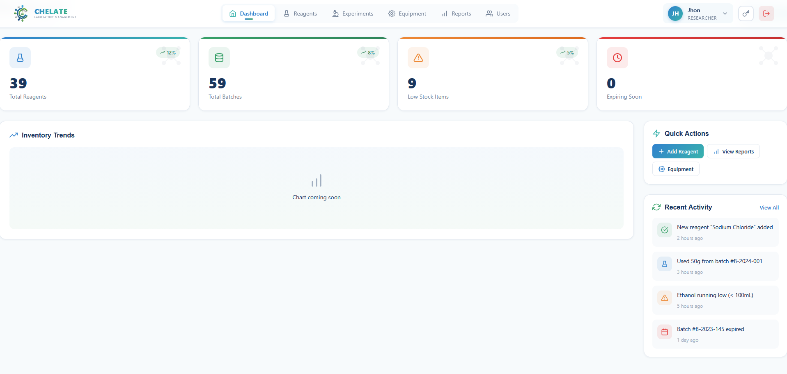
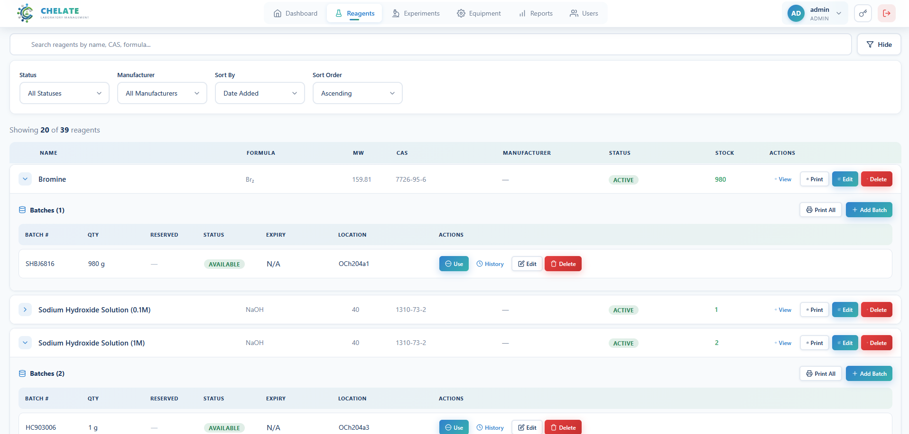
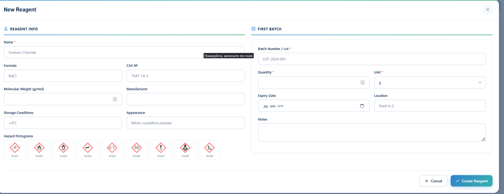
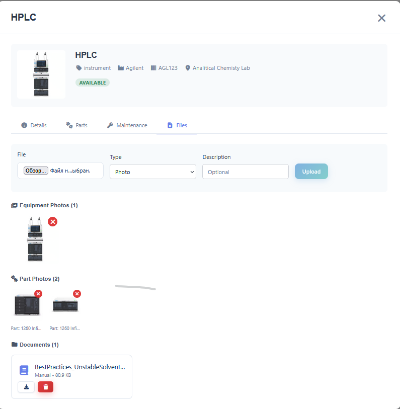

# Chelate LIMS


**A high-performance Laboratory Information Management System built with Rust and React.**

*Currently deployed and actively used in an ISO 17025 certified laboratory environment.*

---

## Overview

Chelate LIMS is a modern web-based system for chemical inventory tracking, equipment maintenance, and laboratory workflow management. Designed specifically for academic and research laboratories, it is built to stay fast on large datasets (indexed queries, FTS5 search, server-side pagination).

### Why Chelate?

| Problem | Solution |
|---------|----------|
| Legacy LIMS are slow and clunky | Rust backend, indexed SQLite queries, server-side pagination |
| Vendor lock-in with proprietary formats | Source available, a single SQLite file, plain REST/JSON API, CSV/Excel/JSON import and export |
| Manual paper trails and errors | Audit log, per-bottle history, scan-based inventory checks |
| Expensive per-seat licensing | Self-hosted, free for academic and other noncommercial use |

> **In Production:** Protocol generation time reduced by ~90%, manual inventory errors eliminated.

---

## Gallery

### Dashboard & Analytics
*Real-time overview of reagent stocks, expiring batches, low-stock alerts, and recent activity feed.*



### Chemical Inventory with Batch Management
*Expandable reagent list with batch tracking, usage history, and quick actions.*



### New Reagent Form (GHS Compliant)
*Comprehensive reagent entry with molecular data, storage conditions, and GHS hazard pictogram selection.*



### Reagent Usage Tracking
*Track consumption history per batch with user attribution and purpose logging.*


### Label Printing with Safety Information
*One-click generation of GHS-compliant stickers with hazard pictograms, CAS numbers, and storage conditions.*


### Equipment Management with Parts Tracking
*Hierarchical equipment structure with sub-component tracking (pumps, samplers, columns).*


### Equipment List View
*Search and filter equipment by type, status, and serial number. Expandable parts view.*


### Maintenance Scheduling
*Track calibrations, cleaning schedules, and maintenance history for ISO 17025 compliance.*


### Equipment Documentation
*Attach photos, manuals, and technical documents to equipment records.*



### Add Equipment Form
*Register new instruments with photos, warranty information, and location tracking.*


### Granular Permission System
*Fine-grained role-based access control per module (Reagents, Batches, Equipment, Experiments, Reports).*


---

## Features

### Chemical Management
- **Full-Text Search** — FTS5 search across reagents, with automatic fallback to `LIKE`
- **Batch Tracking** — Trace every gram from receipt to usage with lot numbers; requalification history for expired batches
- **Low-Stock Alerts** — A batch is low on stock when what is left drops below a percentage of its original quantity (`LOW_STOCK_PERCENT`, default 20%), so 10 L of a 25 L drum and 10 mg of a 100 mg vial are judged by the same rule
- **GHS Classification** — Hazard pictograms and safety data, printable as stickers
- **Expiry Alerts** — Expiring and expired batches on the dashboard and in reports
- **Hierarchical Storage** — Room → Cabinet (zone) → Shelf (position), with the contents of every level
- **Bottle Labels** — A Data Matrix label for every bottle, printed on A4 (plain paper to cut, or sticker sheets); scan it with a phone to see the bottle, write off an amount or move it
- **Bottle History** — Every placement, move, draw, disposal and inventory sighting of a bottle is journaled with who, when, where from and where to; the journal is never pruned
- **Inventory Checks** — Scan every bottle in a room, cabinet or shelf; Chelate lists what is misplaced, unrecorded or missing, lets you fix it on the spot and keeps a printable record
- **Import / Export** — Reagents, batches and equipment via CSV, Excel or JSON
- **Archive** — Deleted reagents and equipment are soft-deleted and can be restored by an admin under `/admin/archive`

### Experiments & Reports
- **Experiments** — Plan experiments, attach reagents, start / complete / cancel them; consumption is written off from the chosen batch automatically; calendar view
- **Reports** — Presets and custom field selection, exportable

### Equipment & Assets
- **Maintenance Scheduler** — Calibrations, cleaning and maintenance with history (ISO 17025)
- **Parts Tracking** — Monitor sub-components (lamps, columns, seals)
- **Documentation** — Photos, manuals and other files attached to equipment and parts
- **Status Dashboard** — Equipment availability at a glance

### Security & Compliance
- **JWT Authentication** — HMAC-signed tokens; the signing secret is rotated automatically every 3 days
- **Password Hashing** — bcrypt; login lockout after repeated failures
- **Role-Based Access** — Roles Admin, Researcher and Viewer, plus per-user permissions per module (Reagents, Batches, Equipment, Experiments, Reports)
- **Audit Logging** — Complete activity tracking for regulatory compliance
- **SQL Injection Protection** — Parameterized queries throughout
- **Security Headers** — `X-Frame-Options`, `nosniff`, `Referrer-Policy`; HSTS when HTTPS is required

### Performance
- **Indexed Queries & FTS5** — Search stays fast on large inventories
- **Server-side Pagination** — Filtered, sorted pages for large result sets
- **Virtual Scrolling** — Smooth frontend UX with long reagent lists
- **Connection Pooling** — Concurrent request handling

---

## Tech Stack

| Layer | Technology |
|-------|------------|
| **Backend** | Rust, Actix-web 4, Tokio |
| **Database** | SQLite (FTS5), SQLx; tables and migrations are created automatically on start |
| **Auth** | JWT (HMAC, rotating secret), bcrypt password hashing |
| **Frontend** | React 18 (JavaScript, Create React App), inline styles, zxing-wasm for Data Matrix |
| **Deploy** | Single binary + static frontend build, Linux (systemd), behind nginx for HTTPS |

---

## Quick Start

### Prerequisites

- Rust 1.70+ (stable)
- Node.js 18+
- SQLite with FTS5 (bundled with the Rust SQLite driver)

### Installation

```bash
git clone https://github.com/Emil9405/Chelate
cd Chelate

# Backend (the Rust crate is in the repository root; the binary is called `lims`)
cargo build --release

# Frontend
cd lims-frontend
npm install
```

There is no separate database or key setup step. On the first start the server:

- creates the SQLite database file and all tables;
- generates a `JWT_SECRET` and saves it to `.env` if there is none;
- creates the user `admin`. Its password is `DEFAULT_ADMIN_PASSWORD` if that is set, otherwise a random one printed **once** in the server log. Change it after the first login.

### Running

**Development:**
```bash
# Terminal 1: Backend (http://localhost:8080)
cargo run

# Terminal 2: Frontend (http://localhost:3000, API requests are proxied to :8080)
cd lims-frontend && npm start
```

**Production:**
```bash
# Build the frontend
cd lims-frontend && npm run build && cd ..

# Run the backend; it also serves the built frontend
LIMS_ENV=production \
FRONTEND_BUILD_DIR=/path/to/Chelate/lims-frontend/build \
./target/release/lims
```

In production mode the server refuses to start with a short or default `JWT_SECRET` or with `*` in `ALLOWED_ORIGINS`. Set `FRONTEND_BUILD_DIR` explicitly: the default (`../lims-frontend/build`) is relative to the directory you start the binary from.

**Scanning labels with a phone:** live camera scanning needs the site to be opened over
HTTPS (browsers expose the camera only to secure pages), for example with nginx and a
certificate in front of the server. Over plain HTTP the Scan page
falls back to taking a photo of the label, which works on any phone. A USB or Bluetooth
scanner in keyboard mode works on the same page, and so does typing the 8-character code
printed under each symbol.

---

## Project Structure

```
Chelate/
├── Cargo.toml
├── src/                         # Rust backend (crate `lims`)
│   ├── main.rs                  # startup, CORS, static files
│   ├── config.rs                # .env / environment configuration
│   ├── db.rs                    # schema, migrations, FTS5
│   ├── auth.rs, auth_handlers.rs, jwt_rotation.rs
│   ├── *_handlers.rs            # reagents, batches, containers, storage, rooms,
│   │                            #   equipment, experiments, reports, labels, inventory
│   ├── consumption.rs           # the single write-off path and low-stock rule
│   ├── container_history.rs     # bottle journal and placement changes
│   ├── models/                  # data models
│   ├── query_builders/          # filters, FTS queries
│   ├── import_export/           # CSV / Excel / JSON
│   └── routes/                  # route tables, permission checks per module
├── lims-frontend/
│   ├── src/
│   │   ├── components/          # React components
│   │   │   ├── labels/          # Data Matrix labels, scan page, bottle history
│   │   │   ├── inventory/       # inventory checks
│   │   │   ├── storage/         # rooms, cabinets, shelves
│   │   │   ├── Reagents/, Modals/, experiment/
│   │   │   └── hooks/
│   │   └── services/            # API client
│   └── package.json
├── screenshots/
└── README.md
```

---

## API Reference

Login is public; everything under `/api/v1` needs `Authorization: Bearer <token>`.

### Authentication

```http
POST /auth/login
Content-Type: application/json

{"username": "admin", "password": "..."}

→ {"token": "eyJ...", "expires_in": 86400, "user": {...}}
```

Tokens last `AUTH_TOKEN_EXPIRATION_HOURS` hours (default 24). There is no refresh endpoint: log in again when a token expires. Self-registration (`POST /auth/register`) is off unless `AUTH_ALLOW_SELF_REGISTRATION=true`; admins create users under `/api/v1/auth/users`.

### Main endpoints (all under `/api/v1`)

| Area | Endpoints |
|------|-----------|
| Reagents | `GET/POST /reagents`, `GET /reagents/search?q=`, `GET/PUT/DELETE /reagents/{id}`, `GET /reagents/{id}/details`, `GET /reagents/export`, `POST /reagents/import` (also `/import/json`, `/import/excel`) |
| Batches | `GET/POST /reagents/{id}/batches`, `GET/PUT/DELETE /reagents/{rid}/batches/{id}`, `POST …/use`, `GET …/usage`, `GET /batches/low-stock`, `GET /batches/expiring`, `POST /batches/filter` |
| Bottles | `GET/POST /batches/{id}/containers`, `POST /containers/{id}/place`, `PUT /containers/{id}/move`, `DELETE /containers/{id}/unplace`, `POST /containers/{id}/use`, `GET /containers/{id}/history`, `POST /containers/place-bulk`, `move-bulk` |
| Labels | `POST /labels/containers` (label data), `GET /labels/resolve?code=` (scan lookup) |
| Inventory checks | `GET/POST /inventory/sessions`, `GET /inventory/sessions/{id}`, `POST …/scan`, `…/items/{id}/resolve`, `…/close`, `…/cancel` |
| Storage | `/storage/zones`, `/storage/positions`, `/storage/hierarchy`, `/rooms` |
| Equipment | `/equipment`, `/equipment/{id}/parts`, `…/maintenance`, `…/files` |
| Experiments | `/experiments`, `/experiments/{id}/start`, `complete`, `cancel`, `…/reagents` |
| Reports & dashboard | `/reports/presets`, `/reports/generate`, `/reports/export`, `/dashboard/stats` |
| Admin | `/auth/users`, `/auth/users/{id}/permissions`, `/admin/archive/*` |

**Create reagent example:**
```json
{
  "name": "Acetone",
  "cas_number": "67-64-1",
  "formula": "C3H6O"
}
```
Batches (lot number, quantity, unit, expiry, supplier) are added to a reagent with `POST /reagents/{id}/batches`.

---

## Database Schema

SQLite. Tables are created and migrated automatically at startup.

| Group | Tables |
|-------|--------|
| Inventory | `reagents`, `batches`, `batch_containers`, `batch_placements`, `batch_requalifications`, `usage_logs` |
| Storage | `rooms`, `storage_zones`, `storage_positions` |
| History & checks | `container_events` (bottle journal), `inventory_sessions`, `inventory_items` |
| Equipment | `equipment`, `equipment_parts`, `equipment_maintenance`, `equipment_files` |
| Experiments | `experiments`, `experiment_reagents` |
| Users & security | `users`, `user_permissions`, `jwt_rotation_log`, `audit_logs` |

Full-text search uses FTS5 virtual tables over reagents.

---

## Configuration

Configuration is read from the environment and from a `.env` file in the working directory (or the file named by `ENV_FILE`). All variables are optional.

| Variable | Default | Meaning |
|----------|---------|---------|
| `LIMS_ENV` | – | `production` serves the built frontend and enables strict checks |
| `BIND_ADDRESS` | `127.0.0.1` | Address to listen on |
| `LIMS_PORT` | `8080` | Port |
| `DATABASE_URL` | `lims.db` | Path of the SQLite file |
| `JWT_SECRET` | generated | Signing secret; saved to `.env` if missing; rotated automatically |
| `ALLOWED_ORIGINS` | localhost:3000 and :8080 | Comma-separated CORS origins |
| `FRONTEND_BUILD_DIR` | `../lims-frontend/build` | Built frontend (production) |
| `DEFAULT_ADMIN_PASSWORD` | random | Password of the first `admin` user |
| `LOW_STOCK_PERCENT` | `20` | Low-stock threshold, % of a batch's original quantity |
| `AUTH_TOKEN_EXPIRATION_HOURS` | `24` | Token lifetime |
| `AUTH_MAX_LOGIN_ATTEMPTS` / `AUTH_LOCKOUT_DURATION_MINUTES` | `5` / `15` | Login lockout |
| `AUTH_ALLOW_SELF_REGISTRATION` | `false` | Open registration |
| `EQUIPMENT_FILES_DIR` | `./uploads/equipment` | Where equipment files are stored |
| `RUST_LOG` | – | Log level |

Example `.env` for a server:

```bash
LIMS_ENV=production
BIND_ADDRESS=127.0.0.1          # nginx in front, see below
LIMS_PORT=8080
DATABASE_URL=/var/lib/chelate/lims.db
ALLOWED_ORIGINS=https://lims.example.edu
FRONTEND_BUILD_DIR=/opt/Chelate/lims-frontend/build
```

---

## Testing

```bash
# Backend unit tests
cargo test

# Frontend tests
cd lims-frontend && npm test
```

---

## Troubleshooting

| Issue | Solution |
|-------|----------|
| Server exits in production with "Insecure JWT secret" | Set `JWT_SECRET` to a random string of 32+ characters, or remove it from `.env` and let the server generate one |
| Server exits with "Wildcard CORS origins" | Set `ALLOWED_ORIGINS` to your real URL instead of `*` |
| CORS errors in the browser | `ALLOWED_ORIGINS` must contain the exact URL (scheme, host, port) the site is opened at |
| Blank page or 404 for the frontend in production | `FRONTEND_BUILD_DIR` must point to `lims-frontend/build` after `npm run build` |
| Scan page shows no camera | The camera needs HTTPS. Use a certificate, or scan with a photo, a typed code or a USB scanner |
| Forgot a user's password | Another admin can reset it under Users (`PUT /api/v1/auth/users/{id}/reset-password`) |

---

## Roadmap

- [x] Core inventory & equipment modules
- [x] Full-text search (FTS5)
- [x] Role-based access control
- [x] Sticker printing with GHS pictograms
- [x] Audit logging
- [x] Data Matrix bottle labels and phone scanning
- [x] Bottle history journal
- [x] Inventory checks by scanning
- [x] Low-stock alerts as a percentage of the original quantity
- [ ] Shelf labels (scan bottle, then scan shelf)
- [ ] Direct instrument integration (Agilent, Shimadzu)
- [ ] Electronic Lab Notebook (ELN) features
- [ ] Chemical supplier API integration
- [ ] Multi-language support (EN, RU, AZ)
- [ ] Cloud backup & sync

---

## Contributing

1. Fork the repository
2. Create a feature branch: `git checkout -b feature/new-feature`
3. Commit changes: `git commit -m 'Add new feature'`
4. Push: `git push origin feature/new-feature`
5. Open a Pull Request

Please follow Rust conventions (`rustfmt`, `clippy`) and add tests for new features. Run `cargo test` before opening a pull request.

---

## License

Chelate is licensed under the [PolyForm Noncommercial License 1.0.0](LICENSE).

- **Free for noncommercial use:** research, teaching and study, and use by universities, public research institutes, charities and other noncommercial organizations, including modifying the code for your own lab.
- **Commercial use needs a separate license:** running it inside a company, or offering it as a paid product or service. Contact the author.

The source is public, but because commercial use is restricted this is not an OSI-approved open-source license.

---

## Author

**Emil G.**

Research Chemist & Developer at French-Azerbaijani University (UFAZ)

Combining domain expertise in synthetic organic chemistry with systems programming to build better laboratory tools.

---

<p align="center">
  <strong>Version 0.1.0</strong> · Active Development
</p>
